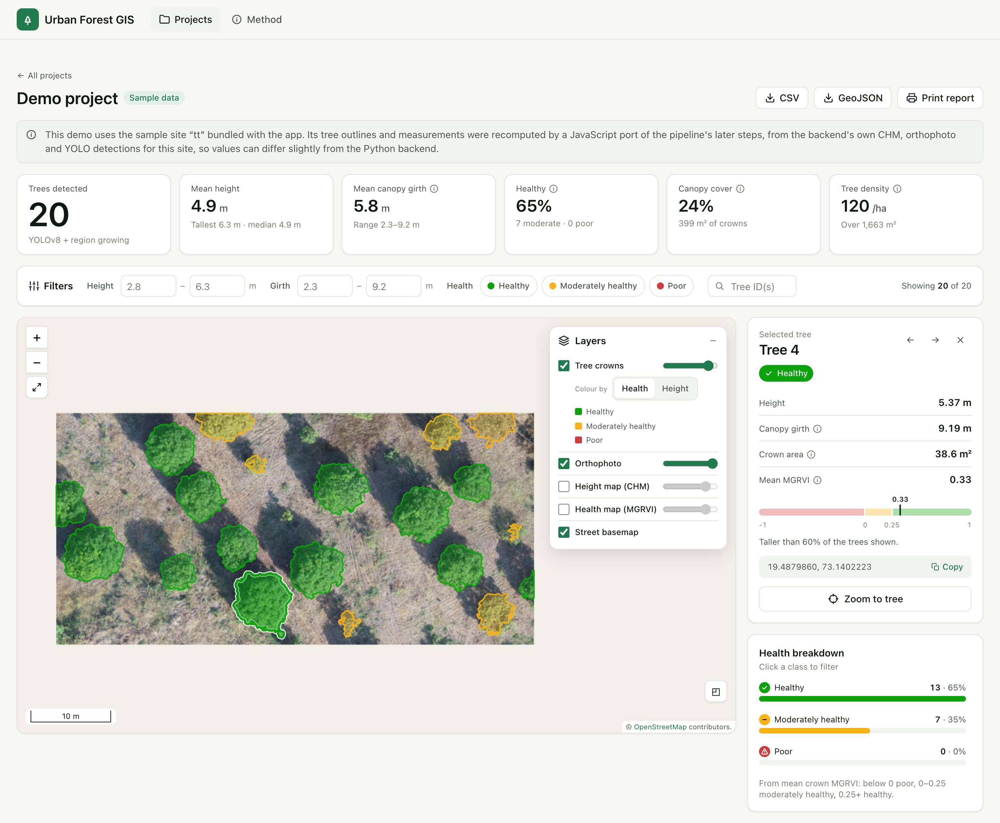
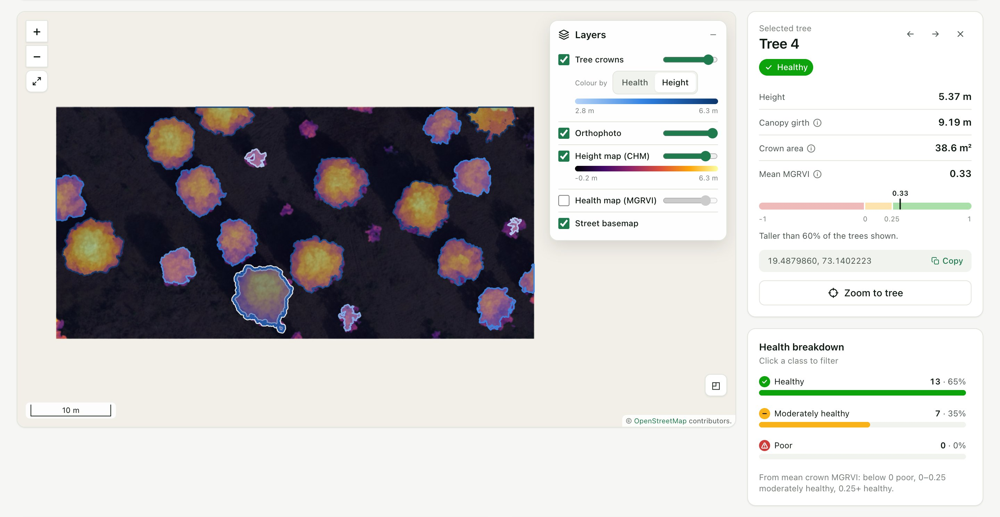
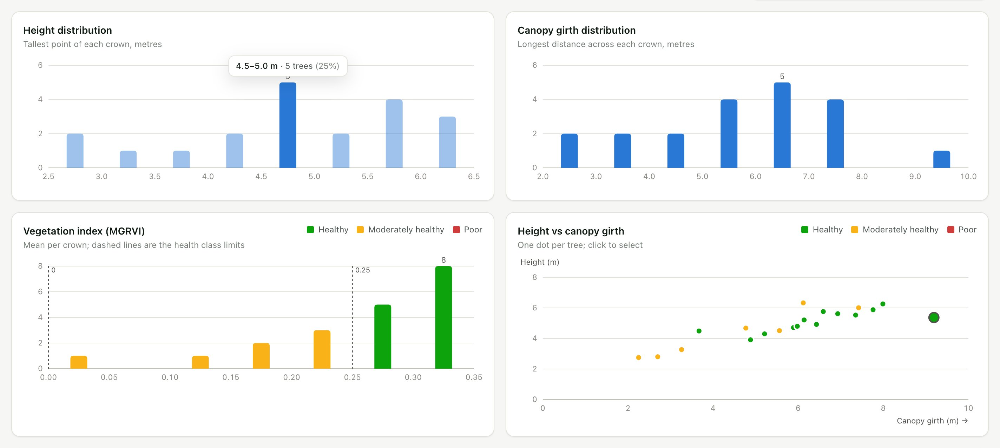

# GIS Based Automated Tool for Urban Forest Management using UAV Data

**Live demo:** https://tushargarje750-alt.github.io/urban-forest-gis/
(explore a sample site in the browser; no installation needed)



<details>
<summary>More screenshots</summary>

Crowns coloured by height over the canopy height model (CHM) layer:



Distributions of height, canopy girth and MGRVI, and height against canopy girth:



</details>

**Abstract.** This project addresses the challenge of urban forest management by creating a GIS-based automated tool that utilizes machine learning and remote sensing technologies. The aim is to enhance tree detection in vegetated areas, which is achieved by integrating a region-growing algorithm with the YOLOv8 machine learning model. This integration significantly improves the model's tree detection capabilities. Additionally, the project uses topographic data to calculate tree heights and canopy girth and employs the Modified Green Red Vegetation Index (MGRVI) for assessing vegetation health. The outcomes demonstrate the effective application of this integrated approach in urban tree detection and analysis. A WebGIS platform is developed to visualize tree height, urban forest health, and distribution, facilitating informed decision-making for urban environmental planning and sustainability.

## What it does

Upload three GeoTIFFs of a site (RGB orthophoto, DEM and DTM) and get, for every detected tree:

- its crown outline on a map
- height (m), from the canopy height model (DEM − DTM)
- canopy girth (m), the longest distance across the crown
- health (healthy / moderately healthy / poor), from the crown's mean MGRVI

plus map layers for the orthophoto, a colour-coded height map and an MGRVI health map.

## Repository layout

```
app.py                Flask backend (API + original HTML pages)
app/sharanga.py       processing pipeline: CHM, YOLOv8, region growing, metrics, PostGIS
app/geoserver.py      publishes the rasters to GeoServer
app/logout.py         standalone cleanup script (deletes all projects and layers; not called by app.py)
models/nbbbest.pt     trained YOLOv8 weights
db/schema.sql         database tables the backend expects
templates/, static/   original web pages served by Flask
react-frontend/       new web interface (React + OpenLayers), see its README
```

Survey data (`app/tif_files/`) and pipeline output (`runs/`) are not in the repository because of their size.

## Requirements

- Python 3.12
- PostgreSQL with PostGIS
- GeoServer (on port 8080)
- Node.js 18 or newer (for the web interface)

## Setup

### 0. Local settings

```bash
cp .env.example .env
```

Fill in your PostgreSQL password, a Flask secret key and your GeoServer login.
`.env` is git-ignored; no passwords are stored in the code.

### 1. Database

```bash
psql -U postgres -c 'CREATE DATABASE "TREE";'
psql -U postgres -d TREE -f db/schema.sql
```

Keep the double quotes in the first command: the backend connects to `TREE` in capitals.

### 2. GeoServer

Start GeoServer on `http://localhost:8080/geoserver` and create a workspace named **`Sharanga`**
(the pipeline publishes its layers there).

### 3. Python environment

```bash
python -m venv .venv
source .venv/bin/activate          # Windows: .venv\Scripts\activate
pip install -r requirements.txt
```

Then install GDAL (the original environment used 3.9.2):

- **Windows:** download the GDAL wheel for Python 3.12 from
  [cgohlke/geospatial-wheels](https://github.com/cgohlke/geospatial-wheels/releases) and
  `pip install` that file.
- **macOS:** `brew install gdal`, then `pip install "GDAL==$(gdal-config --version)"`.
- **Ubuntu/Debian:** `sudo apt install gdal-bin libgdal-dev`, then `pip install "GDAL==$(gdal-config --version)"`.

### 4. Run the backend

Run it from the repository root, because the pipeline uses paths relative to it:

```bash
python app.py
```

On macOS, port 5000 is used by AirPlay Receiver. Use another port instead:

```bash
flask --app app run --port 5001
```

### 5. Run the web interface

```bash
cd react-frontend
npm install
npm run dev
```

Open http://localhost:3000. If the backend is not on port 5000, create `react-frontend/.env.local`
with `VITE_API_BASE=http://localhost:5001` (see `react-frontend/.env.example`).
The interface includes a demo project that works without the backend.

## Known limitations

- If processing fails with an error about `proj.db`, set `PROJ_LIB` in `.env` to your PROJ data folder.
- One analysis runs at a time: the processing status is shared by all users.
- The upload request stays open until processing finishes, which can take several minutes for large surveys.
